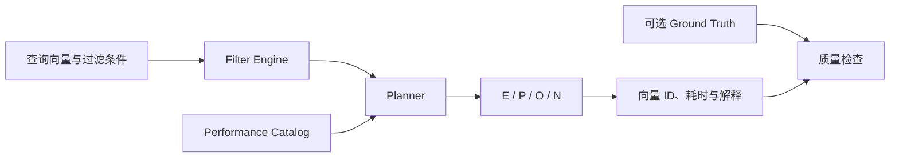
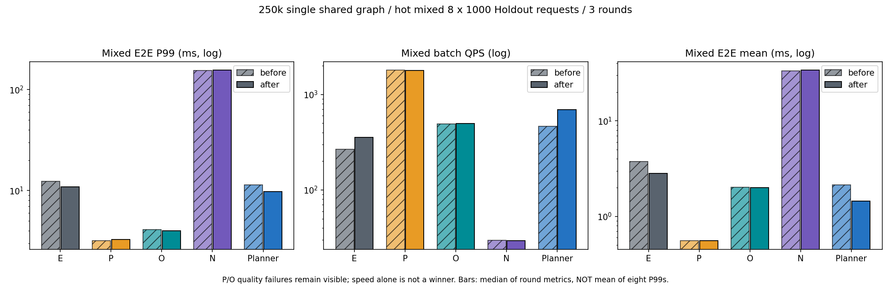

# Adaptive Filtered ANN Planner

Java 过滤向量检索规划器，基于 JVector 在精确扫描与 ANN 路径之间选择策略和候选预算。

过滤条件会改变向量检索的成本：ANN 后过滤可能返回不足，扩大候选池会增加搜索开销，原生过滤也可能遍历大量节点。本项目根据目标 Recall、过滤位图和历史性能数据选择执行路径，并返回选择理由。

## 功能

- **四种检索路径**：精确扫描 E、Top-10 后过滤 P、扩大候选池 O、原生过滤 N。
- **质量优先规划**：先筛选满足历史 Recall 目标的配置，再比较请求成本。
- **位图复用**：LRU 过滤缓存，以及精确扫描的匹配 ID 缓存。
- **可解释结果**：返回策略、预算、向量 ID、耗时及候选配置的排除原因。
- **统一接口**：Java API、CLI、JSON 请求和交互查询。

## 快速开始

环境：Java 21、PowerShell 7。克隆完整仓库后，在仓库根目录运行：

```powershell
.\adaptive-planner\scripts\demo-all.ps1 -Build -Synthetic
```

Synthetic 使用 1,024 条 8 维向量，无需下载数据。它实际执行查询；由于没有对应的性能校准，Planner 选择精确扫描。

自定义向量：

```powershell
.\adaptive-planner\run.ps1 -Synthetic -Request adaptive-planner/examples/query-synthetic.json
```

准备好 [SIFT 数据与标签](docs/data-setup.md) 后，可运行多策略示例：

```powershell
.\adaptive-planner\scripts\demo-all.ps1 -Build
.\adaptive-planner\run.ps1 -Interactive
```

交互输入格式：

```text
0 | R-rank-100000 | .95 | 40 | hot
0 | region=1 | .95 | 40 | cold
exit
```

## 策略与规划

| 策略 | 执行方式 |
|---|---|
| E | 精确计算过滤集合的 double Squared L2，返回 Top-10 |
| P | 执行 ANN Top-10，再过滤结果 |
| O | 返回更多 ANN 候选，过滤后取 Top-10 |
| N | 使用 JVector acceptOrds 接受满足过滤条件的结果 |

Planner 匹配数据身份、过滤签名、位图内容及缓存状态。候选配置需要在三轮 Tuning 中均达到目标平均 Strict Recall，然后按三轮 E2E 均值的中位数选择。预算来自已测的 10 / 40 / 160 / 640；E 的预算记为 0。

未知条件、未校准数据和冷缓存请求使用 E。目标 Recall=1 时使用精确扫描。历史平均 Recall 不是单查询保证：提供绑定 Ground Truth 时，API 才能计算 Actual Recall，并在 ANN 质量不足时回退 E；无 GT 时该字段为 `null`。



## 性能

250k × 128维 SIFT 前缀图，八种过滤条件等权混合、每条件1,000条 Holdout 查询、单线程、热位图、三轮。表中为三轮性能指标中位数，Recall取最小轮均值。

| 方案 | E2E P99（ms） | QPS | Strict Recall |
|---|---:|---:|---:|
| E | 10.9145 | 355.18 | 1.0000 |
| N | 155.1933 | 29.48 | 0.9888 |
| Planner | **9.7271** | **692.79** | 0.9953 |

在该负载和 Recall≥.95 条件下，E 是最佳固定策略；Planner 的 P99 低 10.9%，QPS 高 95.1%。P/O 因 Recall 不足未列为赢家，完整结果包含它们。



精确路径通过缓存匹配 ID，省去每次查询对全部位图位置的重复判断。优化前后保持同一张图，120,000 对请求返回 ID 一致。收益主要来自稀疏过滤，宽过滤仍受距离计算成本影响。

[性能报告](docs/v0.3-performance/performance-report.md) · [优化分析](docs/v0.3-performance/optimization-report.md) · [逐轮数据](docs/v0.3-performance/summary.csv)

## Java API

```java
try (var runtime = PlannerRuntime.open(repositoryRoot, 250_000, false);
     var session = runtime.newSession()) {
    var filter = FilterSpec.known("R-rank-100000");
    runtime.prepare(filter);
    var request = new QueryRequest(runtime.queryVector(0), filter, 0.95, 40, false);
    var response = session.query(request);
    System.out.println(response.selectedStrategy());
    System.out.println(response.resultVectorIds());
    System.out.println(response.decision().reason());
}
```

每个线程使用独立 Session/Searcher，共享只读图。当前固定 Top-10，支持四种字段的 EQ/LT 及 AND；图在进程内构建和驻留。

## 构建与性能复现

```powershell
.\mvnw.cmd -B -f adaptive-planner/pom.xml "-Dtest=Planner*Test" "-Dsurefire.failIfNoSpecifiedTests=false" package
# 完整性能比较，需要SIFT资产，约数十分钟
.\adaptive-planner\scripts\performance.ps1 -Build
# 离线生成报告，需要Python 3.12和Matplotlib
python adaptive-planner/scripts/performance-report.py
```

产品位于 `adaptive-planner/`，依赖相邻的 `bench-core/` 和 `bench-jvector/`。Maven Wrapper 管理构建，GitHub Actions 执行 Java 21 编译、测试和 Synthetic 示例。

[架构](docs/architecture.md) · [示例](docs/demo-guide.md) · [数据准备](docs/data-setup.md) · [历史性能目录](docs/performance-guide.md) · [变更记录](CHANGELOG.md) · [许可证](docs/license-review.md)

## License

[Apache-2.0](LICENSE) · [第三方声明](THIRD_PARTY_NOTICES.md)
