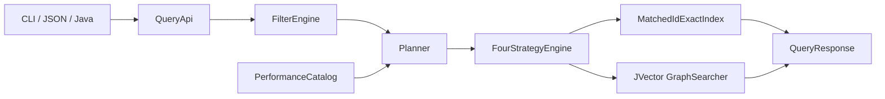

# 架构

产品是一个 Java 模块，按职责分包，复用仓库中的 `bench-core` 和 `bench-jvector`。

| 包 | 职责 |
|---|---|
| api | 请求校验、统一执行、结果封装与可选 GT 质量检查 |
| filter | AND 条件规范化、过滤位图和容量64的 LRU |
| catalog | 读取真实性能记录，校验来源并重算三轮统计 |
| core | 按质量目标与成本选择策略、预算，生成解释 |
| engine | E/P/O/N 执行、向量存储和图构建 |
| demo | 数据装配、CLI 与性能比较入口 |

## 数据与索引

RowsVectorStore 持有一份行向量 payload，供 JVector 和 double 距离计算共用。Runtime 创建一张内存图，关闭时释放；每线程创建独立 QueryApi Session 和 GraphSearcher。

精确扫描默认使用 MatchedIdExactIndex：缓存不可变位图对应的升序 ID，随后仅遍历匹配向量。弱键缓存允许已淘汰位图回收。ProductExactIndex 保留为性能对照，两者距离、Top-K及并列排序规则一致。

## 规划依据

目录身份包括源数据哈希、250k前缀、128维、过滤签名、基数及位图哈希。只有匹配身份的热请求使用历史Tuning记录；冷请求和未知条件走精确扫描。

三轮Tuning平均Strict Recall均达标后，按E2E均值中位数选配置。Holdout用于评价。当前图延迟预测为null，历史值在响应中单独标识。

## 质量与计时

GT绑定数据、查询向量指纹和过滤位图；DiskTruth按请求读取Top-10。传入GT时，ANN的实际Strict Recall不足会触发E，并保留全部尝试。没有GT时Actual Recall为null。

queryLatencyNanos覆盖请求处理，searchNanos累计检索调用，verificationNanos记录质量校验。性能比较使用API调用外层墙钟，GT复算在计时外进行。详见[基准方法](v0.3-performance/protocol.md)。
