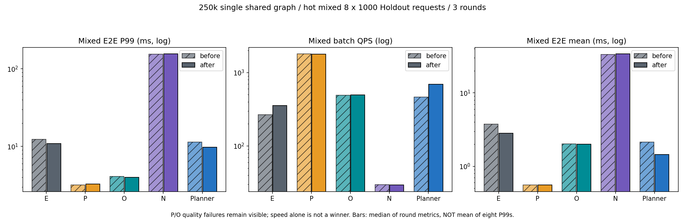
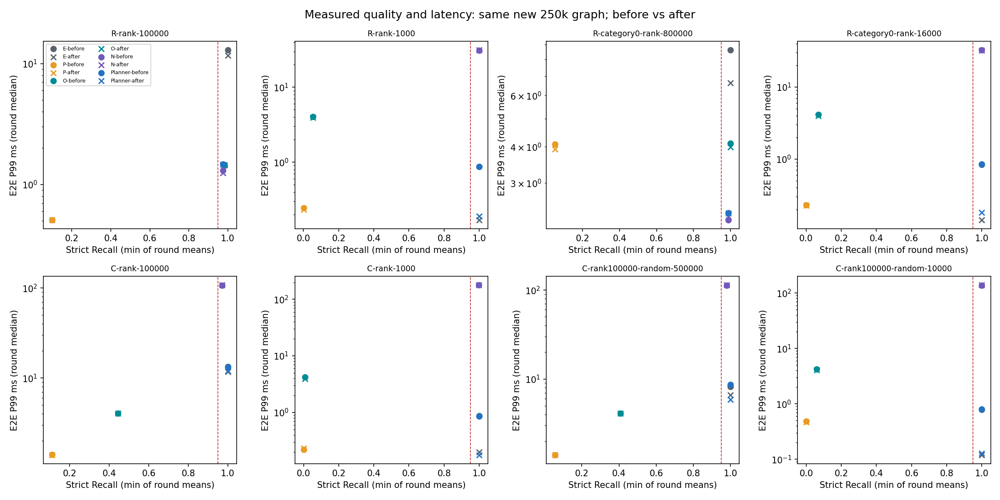

# 产品检索性能

数据：250k × 128维，Build `product-demo-eec01b7f-4bc8-4242-b66d-364c153945d8`。八过滤器等权混合，各1000条Holdout，单线程、热位图、三轮；优化前后共240000请求。

预算由Tuning选择，质量在计时外复算。P99来自每轮8000个混合请求的真实样本，QPS使用批次墙钟。下面展示三轮性能中位数，Strict取最小轮均值。完整方法见[基准方法](protocol.md)。

## 混合负载

|阶段|方案|Strict Recall|P99 ms|QPS|E2E Mean ms|达.95|
|---|---|---:|---:|---:|---:|---|
|before|E|1.000000|12.379100|266.907|3.746403|YES|
|before|P|0.040000|3.190800|1794.411|0.557147|NO|
|before|O|0.378387|4.105600|493.058|2.027959|NO|
|before|N|0.988800|154.612300|29.853|33.496624|YES|
|before|Planner|0.995313|11.431500|466.170|2.144849|YES|
|after|E|1.000000|10.914500|355.183|2.815065|YES|
|after|P|0.040000|3.271000|1788.470|0.559011|NO|
|after|O|0.378387|3.989700|499.199|2.002978|NO|
|after|N|0.988800|155.193300|29.485|33.915281|YES|
|after|Planner|0.995313|9.727100|692.786|1.443267|YES|

在每过滤器每轮Recall均达.95的方案中，E是混合P99最低的固定策略。优化后Planner相对E：P99降低10.9%，QPS提高95.1%。P/O质量不足。这个比较适用于此等权热负载。

## 各过滤器：优化后

|过滤器|方案|预算|Strict|P50 ms|P95 ms|P99 ms|QPS active-wall|Mean ms|实际策略|回退|
|---|---|---|---:|---:|---:|---:|---:|---:|---|---:|
|R-rank-100000|E|0|1.000000|7.013100|10.811200|11.707000|130.929|7.637707|E:1000|0|
|R-rank-100000|P|40|0.099700|0.233300|0.411400|0.506900|3931.141|0.254379|P:1000|0|
|R-rank-100000|O|160|0.984200|0.680200|1.209200|1.441900|1363.169|0.733585|O:1000|0|
|R-rank-100000|N|10|0.973900|0.516400|0.975600|1.240500|1791.962|0.558048|N:1000|0|
|R-rank-100000|Planner|10|0.973900|0.551500|1.105200|1.458900|1655.481|0.604054|N:1000|0|
|R-rank-1000|E|0|1.000000|0.068500|0.134200|0.168700|14336.609|0.069751|E:1000|0|
|R-rank-1000|P|10|0.000400|0.104800|0.189900|0.232600|8660.746|0.115463|P:1000|0|
|R-rank-1000|O|640|0.053300|2.054500|3.437300|3.951400|458.304|2.181957|O:1000|0|
|R-rank-1000|N|10|0.999900|20.215000|27.983300|31.436600|49.127|20.355297|N:1000|0|
|R-rank-1000|Planner|0|1.000000|0.071600|0.147900|0.189500|13655.811|0.073229|E:1000|0|
|R-category0-rank-800000|E|0|1.000000|3.335700|6.080000|6.628600|269.493|3.710670|E:1000|0|
|R-category0-rank-800000|P|640|0.050400|2.064200|3.470300|3.927500|456.239|2.191835|P:1000|0|
|R-category0-rank-800000|O|640|0.999300|2.072000|3.431100|3.983100|456.813|2.189080|O:1000|0|
|R-category0-rank-800000|N|10|0.988600|0.866600|1.735100|2.305700|1053.179|0.949506|N:1000|0|
|R-category0-rank-800000|Planner|10|0.988600|0.913000|1.735800|2.362300|1006.462|0.993579|N:1000|0|
|R-category0-rank-16000|E|0|1.000000|0.053600|0.107000|0.142100|17917.197|0.055812|E:1000|0|
|R-category0-rank-16000|P|10|0.001500|0.104500|0.184400|0.227900|8795.469|0.113695|P:1000|0|
|R-category0-rank-16000|O|640|0.069400|2.078500|3.455600|3.956700|456.134|2.192339|O:1000|0|
|R-category0-rank-16000|N|10|1.000000|19.021500|27.906800|32.130100|51.685|19.347991|N:1000|0|
|R-category0-rank-16000|Planner|0|1.000000|0.067900|0.142500|0.181800|14487.588|0.069025|E:1000|0|
|C-rank-100000|E|0|1.000000|6.940600|10.807500|11.761900|132.434|7.550909|E:1000|0|
|C-rank-100000|P|160|0.111600|0.675500|1.174000|1.391200|1401.558|0.713491|P:1000|0|
|C-rank-100000|O|640|0.443400|2.047200|3.469400|4.055700|459.217|2.177619|O:1000|0|
|C-rank-100000|N|10|0.970900|6.928800|100.350300|107.983500|28.752|34.779849|N:1000|0|
|C-rank-100000|Planner|0|1.000000|6.365300|10.154500|11.986500|144.313|6.929392|E:1000|0|
|C-rank-1000|E|0|1.000000|0.076200|0.143600|0.198900|12878.184|0.077651|E:1000|0|
|C-rank-1000|P|10|0.000000|0.104600|0.189000|0.232700|8661.256|0.115457|P:1000|0|
|C-rank-1000|O|640|0.008400|2.074400|3.460600|3.954000|453.697|2.204116|O:1000|0|
|C-rank-1000|N|10|0.998600|82.797200|162.390000|179.562700|10.904|91.711712|N:1000|0|
|C-rank-1000|Planner|0|1.000000|0.059700|0.121000|0.175700|15634.821|0.063960|E:1000|0|
|C-rank100000-random-500000|E|0|1.000000|3.119900|5.596900|6.622700|294.984|3.390017|E:1000|0|
|C-rank100000-random-500000|P|160|0.055500|0.679800|1.192800|1.404400|1371.396|0.729184|P:1000|0|
|C-rank100000-random-500000|O|640|0.408800|2.056500|3.520100|4.130900|454.054|2.202383|O:1000|0|
|C-rank100000-random-500000|N|10|0.979700|10.006700|104.202700|114.067600|26.293|38.033580|N:1000|0|
|C-rank100000-random-500000|Planner|0|1.000000|2.511300|4.892900|5.856600|358.813|2.786967|E:1000|0|
|C-rank100000-random-10000|E|0|1.000000|0.041100|0.084500|0.119300|22271.913|0.044900|E:1000|0|
|C-rank100000-random-10000|P|40|0.000900|0.232600|0.401500|0.472200|3984.780|0.250955|P:1000|0|
|C-rank100000-random-10000|O|640|0.060300|2.045500|3.458200|4.117700|457.517|2.185711|O:1000|0|
|C-rank100000-random-10000|N|10|0.998800|38.701900|131.285900|140.004000|15.243|65.605609|N:1000|0|
|C-rank100000-random-10000|Planner|0|1.000000|0.039700|0.081400|0.127300|23045.245|0.043393|E:1000|0|

过滤器QPS按其请求墙钟区间之和计算；完整270行轮次统计见[summary.csv](summary.csv)。主测API无GT参数，回退为0，质量在批次后评价。

## 内存

|采样指标|优化前 MiB|优化后 MiB|
|---|---:|---:|
|Heap used峰值|963.406|965.966|
|Heap committed峰值|1024.000|1024.000|

匹配ID数组增加约300.7 KiB理论payload，另有对象开销。Private/Working Set的基线仅覆盖末段，不能作完整峰值比较；Heap为全程1Hz采样。

## 适用范围

结果基于一张图、单线程及固定等权分布。前后顺序可能受JIT、温度和后台负载影响。稀疏过滤受益较大；高频更换过滤器、冷缓存及不同数据规模需要另测。

复现命令和原始字段说明见[基准方法](protocol.md)，代码变化见[优化分析](optimization-report.md)。
